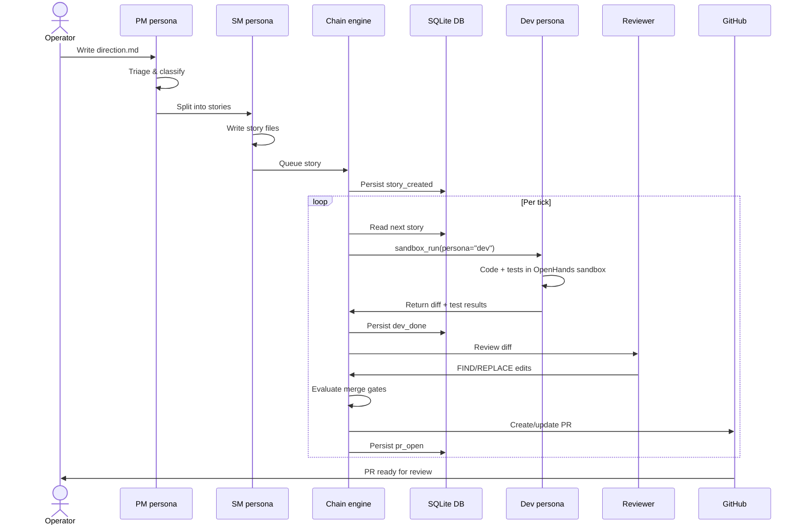

# Architecture diagrams

## System-level flowchart

```mermaid
flowchart TD
    subgraph User["User / Operator"]
        DIR[("Direction (markdown work order)")]
        CLI[("factory CLI commands")]
    end

    subgraph Factory["software-factory orchestrator"]
        PM[PM persona\nTriage & split]
        SM[SM persona\nStory files]
        DEV[Dev persona\nOpenHands sandbox\ncode + tests]
        REV[Reviewer persona\nFIND/REPLACE edits]
        TW[Tech-writer persona\nContext refresh]
        GATES[Merge gates\nTests / Smoke /\nCanonical paths]

        CHAIN[Chain engine\nState machine + handlers]
        DETECTORS[Detectors\nConformance / Cost /\nStall / Retry]
        OBSERV[Observability\nAudit chain /\nConformance model]
    end

    subgraph Storage["Persistence"]
        DB[(SQLite\nstate/factory.db)]
        EVENTS[("state/events/\nNDJSON streams")]
        WORKTREES[("worktrees/\ngit clones")]
    end

    subgraph External["External services"]
        GH[GitHub API\nIssues / PRs / repos]
        LLM[LLM providers\nAzure / DeepSeek /\nOpenRouter]
        TERM[termhub session\n(for claude_session\nruntime)]
    end

    DIR --> PM
    PM --> SM
    SM --> CHAIN
    CHAIN --> DEV
    DEV --> REV
    REV --> GATES
    GATES --> TW
    TW --> GH

    CHAIN <--> DB
    CHAIN <--> EVENTS
    CHAIN <--> WORKTREES
    CHAIN <--> DETECTORS
    DETECTORS --> OBSERV

    DEV <--> LLM
    REV <--> LLM
    GH <--> CHAIN
    TERM -.->|claude_session\nruntime| DEV

    CLI --> CHAIN
```

## Primary user flow — Direction to PR

